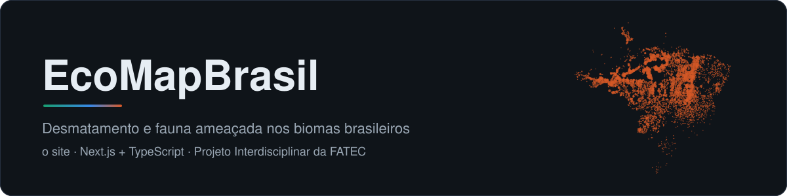
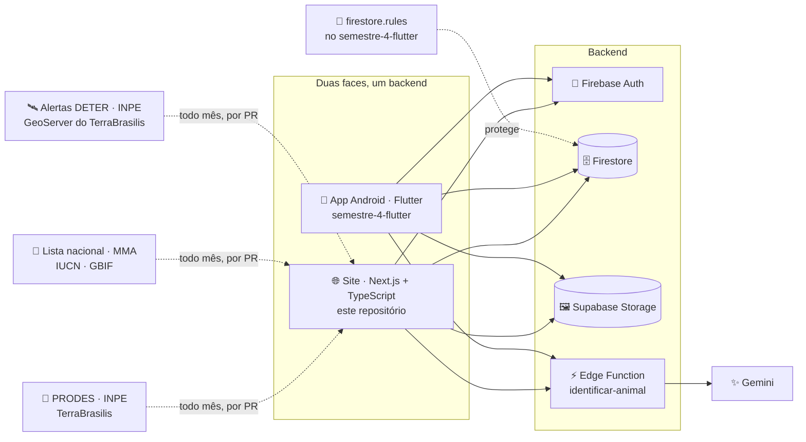

<p align="center">
  
</p>

<p align="center">
  
  
  
  
  
  
</p>

O **EcoMapBrasil** mostra num lugar só **onde** o desmatamento acontece nos biomas
brasileiros, **quais espécies** estão ameaçadas e o que dá para fazer a respeito. Este
repositório é **o site**, no 4º semestre: o porte da
[versão React do 3º semestre](https://github.com/ecomap-devs/semestre-3-react) para
**Next.js com TypeScript**, exportado como site estático e publicado no Firebase Hosting.

O app Android é o [semestre-4-flutter](https://github.com/ecomap-devs/semestre-4-flutter).
Os dois usam o mesmo backend, então a conta é a mesma e uma avaliação feita no celular
aparece no site.

> [!NOTE]
> **As três telas do React estão portadas** (Início, Mapa e Animais, com login e
> avaliações), com os defeitos conhecidos corrigidos, e o site está no endereço principal
> desde 01/10/2026: **[ecomapbrasil-17756.web.app](https://ecomapbrasil-17756.web.app)**.
> Depois do porte vieram a página **Fotos** (identificação de animal por foto, 02/10), os
> **biomas pelo limite do IBGE** (02/10), um **visual próprio** (22/10), que substituiu o
> do React, e os **dados reais** (28/10) no lugar dos valores de referência herdados do
> React: desmatamento do **PRODES/INPE** e status das espécies na **lista nacional do MMA**
> e na **Lista Vermelha da IUCN**. Em 29/10 vieram os **alertas do DETER** dos últimos 12
> meses no mapa, o **quiz** e a seção **Como denunciar**, com os canais oficiais do Ibama.
> Em 02/11, a **[política de privacidade](https://ecomapbrasil-17756.web.app/privacidade)** e os
> **[termos de uso](https://ecomapbrasil-17756.web.app/termos)**, que valem também para o app.

## 🧭 Onde este repositório entra



## 🛠️ Stack

| Camada | Escolha | Por quê |
|---|---|---|
| **Framework** | Next.js 16 (App Router) · React 19 | Cada página sai como HTML pronto no build, e não como uma `div` vazia montada por JS |
| **Linguagem** | TypeScript `strict` | Decidido em 30/09/2026, no início do porte, que é quando trocar custa menos |
| **Estilo** | Estilo inline, como no React, com as cores em variáveis CSS (`globals.css`) · Tailwind 4 só como base | Um ajuste de cor no `globals.css` vale no site todo; o Tailwind entra pelo reset de estilos |
| **Fontes** | Fraunces nos títulos e Source Sans 3 no texto, pelo `next/font` | Baixadas no build e servidas do próprio site, então a CSP não muda. O app usa as mesmas |
| **Ícones** | Font Awesome 6, pelo npm | O React carregava de um CDN |
| **Mapa** | `leaflet` | O mesmo Leaflet do React, agora pelo npm e com versão fixa (o React baixava do unpkg sem versão) |
| **Conta e dados** | `firebase` (Auth, Firestore) | Login e avaliações em tempo real |
| **Imagens** | `@supabase/supabase-js` | Fotos das espécies e avatares |
| **Dados de desmatamento** | PRODES (INPE), gerado em `src/dados/prodes.ts` por `scripts/prodes/gerar.mjs` | Baixado antes do build e revisado por PR: o site não depende do INPE estar no ar, e a CSP não muda |
| **Alertas do mapa** | DETER (INPE), pelo WFS do GeoServer do TerraBrasilis, gerado por `scripts/deter/gerar.py` com **GeoPandas** (pandas, Shapely, pyproj): `public/alertas-desmatamento.json` para baixar e `public/alertas/` para desenhar | Mesmo esquema do PRODES; os arquivos são servidos pelo próprio site. O Python corrige a topologia, mede a área numa projeção de área igual e dissolve os alertas de cada período |
| **Status das espécies** | Lista nacional do MMA (dados abertos, CKAN) e IUCN pela API do GBIF, gerado em `src/dados/especies.ts` por `scripts/especies/gerar.mjs` | Mesmo esquema do PRODES. As duas fontes são abertas: a API da própria IUCN exige chave, e chave não entra no código |
| **Identificação por foto** | Edge Function do Supabase + Gemini | A mesma função do app (o código mora no semestre-4-flutter); a chave do Gemini fica no servidor, e daqui só vai o ID token do Firebase |
| **Hospedagem** | Firebase Hosting, exportação estática | Plano gratuito, e é o único que serve o endereço `web.app` |

## 🚀 Como rodar

> Pré-requisito: Node.js 24. Python 3.14 só para regerar os alertas do DETER.

```bash
git clone https://github.com/ecomap-devs/semestre-4-nextjs.git
cd semestre-4-nextjs
npm install

cp .env.example .env.local     # e preencha os valores
npm run dev                    # http://localhost:3000
```

| Comando | O que faz |
|---|---|
| `npm run dev` | Servidor de desenvolvimento |
| `npm run lint` | ESLint |
| `npm run typecheck` | Gera os tipos das rotas e roda o `tsc` |
| `npm run build` | Exportação estática em `out/`, **sem precisar de credencial** |

> [!IMPORTANT]
> Tudo no `.env.local` é `NEXT_PUBLIC_*` e vai para o navegador: são chaves públicas de
> cliente. Quem protege o dado são as Firestore Rules e o RLS do Supabase. Sem o
> `.env.local`, o site compila, e o primeiro uso do Firebase lança um erro dizendo
> exatamente qual variável falta.

## 🏗️ Exportação estática

`next build` gera um HTML por rota em `out/`, e o Firebase Hosting serve esses arquivos.
Não há servidor, então ficam de fora route handlers, `proxy.ts`, server actions, ISR e o
otimizador do `next/image`. Para este site não custa nada: login, avaliações e mapa já
rodavam no navegador no React.

<details>
<summary>Como o Hosting está configurado (<code>firebase.json</code>)</summary>

| Regra | Por quê |
|---|---|
| `cleanUrls: true` | `/mapa` serve `mapa.html` |
| `trailingSlash: false` | `/mapa/` redireciona para `/mapa` |
| `**` com `no-cache` | O HTML é revalidado a cada visita: deploy novo aparece na hora |
| `/_next/static/**` com `immutable` por um ano | O nome desses arquivos tem hash e muda a cada build |

A ordem importa: **a última regra que casa vence**. E `immutable` só vale em arquivo com
hash no nome. O app Flutter marcou `main.dart.js` assim, e os visitantes ficaram presos
na interface antiga.

Rotas, `cleanUrls`, `trailingSlash` e o 404 foram conferidos no emulador do Hosting. Os
cabeçalhos de cache **não**: o emulador ignora a seção `headers`. Confira no primeiro
deploy:

```bash
for u in / /mapa /_next/static/; do
  echo -n "$u  "; curl -sI "https://ecomapbrasil-17756.web.app$u" | grep -i '^cache-control'
done
```

</details>

## 📊 Sobre os dados

| No site | De onde vem |
|---|---|
| Percentual desmatado de cada bioma (Home e mapa) | PRODES: tudo o que o INPE já mapeou como desmatado ÷ área do bioma no IBGE (2019) |
| "Área desmatada por bioma" e "Desmatado no último ano medido" | PRODES, por bioma, só períodos consolidados. Na Amazônia, floresta e vegetação não florestal somadas |
| Os dois primeiros números da Home | PRODES: total dos seis biomas no período mais recente que todos já têm consolidado, e a variação sobre o anterior |
| Linha do tempo (Home e mapa) | Calculada em `src/dados/linhaDoTempo.ts` a partir da taxa oficial da Amazônia Legal e do acumulado por bioma. Só PPCDAm (2004), Moratória da Soja (2006) e Código Florestal (2012) são escritos à mão, sem número |
| Alertas no mapa | DETER (INPE): os alertas de desmatamento, mineração incluída, dos 12 meses que terminam no alerta mais recente publicado, pelo WFS do TerraBrasilis. `scripts/deter/gerar.py` grava `public/alertas-desmatamento.json` (um alerta por feature, o arquivo do botão de download e do app) e um arquivo por período em `public/alertas/` (1, 3 e 12 meses), com os alertas dissolvidos num só multipolígono e o resumo da legenda pronto. Só Amazônia Legal e Cerrado: o DETER não cobre os outros biomas |
| Quiz | Montado em `src/dados/quiz.ts` a partir dos dados acima. Nenhuma resposta é escrita à mão, menos a cobertura do DETER e os telefones, que vêm de `src/dados/denuncia.ts` |
| Como denunciar | `src/dados/denuncia.ts`, conferido na página [Apresentar denúncia ambiental](https://www.gov.br/pt-br/servicos/apresentar-denuncia-ambiental) do gov.br, com a data da conferência |
| Contorno dos biomas | IBGE, gerado por `scripts/biomas/gerar.mjs` |
| "Espécies ameaçadas no Brasil" (Home e Animais) | Lista nacional do MMA: espécies e subespécies da fauna em CR, EN ou VU no CSV mais recente do [portal de dados abertos](https://dados.mma.gov.br/dataset/especies-ameacadas) (a avaliação de 2021, que virou a Portaria MMA nº 148/2022) |
| Status de cada espécie | "No Brasil": a mesma lista do MMA; fora dela, "Não ameaçada". "No mundo": a Lista Vermelha da IUCN, pela API do GBIF, pelo nome que o GBIF aceita e, quando o GBIF não liga a espécie à IUCN, direto no checklist da IUCN publicado lá |
| População de uma espécie | Só onde há estimativa publicada, com a fonte na ficha (hoje: onça na Mata Atlântica, mico-leão-dourado e arara-azul-de-lear). Escrita à mão em `src/dados/animais.ts` |
| Descrição e ameaças de cada espécie | Escritas à mão em `src/dados/animais.ts`, sem número que não tenha fonte |
| Fotos das espécies | As sete primeiras, no bucket `animals` do Supabase. As outras, do [Wikimedia Commons](https://commons.wikimedia.org), com autor, licença e link na ficha (`credito` em `src/dados/animais.ts`), como as licenças Creative Commons exigem |
| Foto da seção "Passe adiante" | Bruno Kelly/Amazônia Real, do Wikimedia Commons (CC BY 2.0), com o crédito na própria seção (`fotoDaChamadaFinal` em `src/dados/inicio.ts`) |

Para atualizar na mão:

```bash
node scripts/prodes/gerar.mjs     # desmatamento
node scripts/especies/gerar.mjs   # status das espécies
```

Os alertas do DETER precisam de Python e de um ambiente virtual (`.venv`, fora do git):

```bash
python -m venv .venv                                 # no Windows: py -3.14 -m venv .venv
source .venv/bin/activate                            # no Windows: .venv\Scripts\activate
pip install -r scripts/deter/requirements.txt
python scripts/deter/gerar.py --baixar               # baixa do INPE (~1 min) e regera
python scripts/deter/gerar.py                        # regera a partir do cache, sem acessar o INPE
python scripts/deter/gerar.py --forcar               # regrava sem alerta novo, depois de mudar o script
```

As respostas do WFS ficam em `.cache/deter/` (fora do git), para não sobrecarregar o
GeoServer do INPE enquanto se mexe no script: sem `--baixar`, o script lê do cache e
avisa a data do download. Na CI (`CI=true`) ele ignora o cache e baixa sempre.

Sem alerta novo, o script não grava nada: ele compara os alertas (propriedades e
geometria), não os bytes. O download sai igual em Linux e Windows, mas a união dos arquivos
de `public/alertas/` não: em 04/11/2026, com o mesmo dado, deu 1 polígono de diferença nos
12 meses, e o workflow anunciaria dado novo sem haver.

As versões ficam em `scripts/deter/requirements.in`, e o `requirements.txt` sai dele, com os
hashes que o workflow confere (`--require-hashes`). Para mudar uma versão, na pasta
`scripts/deter/`, com o `pip-tools` instalado:
`pip-compile --generate-hashes --strip-extras --no-header --no-emit-index-url --output-file=requirements.txt requirements.in`.

Os ícones do site e a imagem que aparece ao compartilhar o link ficam em `src/app/` e saem
de `scripts/identidade/gerar.py`, que diz como refazer.

<details>
<summary>Detalhes que mudam a leitura dos números</summary>

- **Não é uma API documentada.** O script baixa os mesmos JSON que o
  [painel do TerraBrasilis](https://terrabrasilis.dpi.inpe.br/app/dashboard/deforestation/biomes/cerrado/increments)
  carrega (o endereço vem do código dele, em `terrabrasilis/deforestation_dashboard`).
  Se o formato mudar, o script para com erro em vez de gravar número errado.
- **O ano do PRODES vai de agosto a julho**: "2025" é ago/2024 a jul/2025.
- **Taxa e incremento são contas diferentes.** A taxa da Amazônia Legal (linha do tempo) é a
  estimativa oficial para a região, só de floresta. O incremento por bioma (gráficos) é o
  que foi mapeado dentro do bioma. Por isso os dois números da Amazônia não batem.
- **Dado preliminar** (o período que termina no ano da última atualização do INPE) fica
  fora dos totais da Home e do percentual desmatado de cada bioma (até 02/11/2026 entrava
  no percentual, e o Cerrado aparecia com 53% em vez de 52%). Na linha do tempo, aparece
  como "Estimativa do INPE".
- **Nem todo bioma é medido todo ano.** Até 2013 alguns eram medidos a cada dois ou quatro
  anos. Esses períodos entram no acumulado, mas não na série anual.
- **O status no Brasil e no mundo podem ser diferentes.** A lista nacional avalia a espécie
  só no Brasil; a IUCN, no mundo todo. A onça é vulnerável aqui e quase ameaçada no mundo, e a
  ararinha-azul, reintroduzida em 2022, já é "criticamente em perigo" na lista nacional e
  ainda "extinta na natureza" na IUCN.
- **Não há série de população.** Até 28/10/2026 cada espécie tinha um gráfico de 2000 a 2024
  sem fonte, que saiu. Espécie nova no catálogo entra também em `ESPECIES` de
  `scripts/especies/gerar.mjs`, e o build para se ela faltar ali.
- **A área dos alertas é a do INPE.** A legenda soma o `areaha` de cada alerta (a
  `areamunkm` do DETER em hectares). O `gerar.py` recalcula a área pela geometria numa
  projeção cônica de Albers sobre SIRGAS 2000 (de área igual) e mostra a diferença no
  log: na geometria crua, menos de 0,01% no total. Alertas que se sobrepõem entram duas
  vezes nessa soma; os arquivos de `public/alertas/` trazem também a área sem
  sobreposição (`areaSemSobreposicaoHa`), que hoje não aparece no site.
- **Alerta sem área não é desenhado.** O INPE publica alguns alertas com `areaha` 0 e
  geometria inválida, que depois da correção vira linha ou ponto (29 nos 12 meses até
  23/10/2026). No arquivo de download eles saem com `"geometry": null` e as propriedades
  do INPE; no mapa, não aparecem, mas contam na legenda. Alerta pequeno demais para a grade
  de 0,0001° (~11 m) sai no download com 0,000001°, para não sumir. No desenho do mapa não há
  essa proteção: a simplificação pode apagar uma lasca fina, que continua na legenda e no
  download (31 alertas, 7,7 ha, nos 12 meses até 23/10/2026).
- **O catálogo não é só de espécies ameaçadas.** Desde 28/10/2026 tem também espécies fora
  da lista nacional, como a capivara e o quero-quero, com o status "Não ameaçada". O filtro
  "Só ameaçadas" mostra apenas as da lista, e a Home só destaca ameaçadas.

</details>

## 🔄 CI e deploy

| Workflow | Quando | O que faz |
|---|---|---|
| **CI** | Push ou PR na `main` | Lint, tipos, build e confere que cada rota virou HTML. Não usa secret |
| **Preview do PR** | PR aberto | Dois jobs: o build roda o código do PR **sem** a conta de serviço; um job separado, que não executa código do PR, publica o `out/` num canal de preview que expira em 7 dias |
| **Deploy para produção** | Merge na `main` (ou na mão) | Publica no endereço principal |
| **Dados do PRODES** | Dia 1º de cada mês (ou na mão) | Regera `src/dados/prodes.ts`; se mudou, roda lint, tipos e build, sobe uma branch `dados/…` e abre uma **issue** com o link do PR preenchido. Não usa secret |
| **Dados do DETER** | Dia 1º de cada mês (ou na mão) | O mesmo para `public/alertas-desmatamento.json` (~15 MB, ~2 MB comprimido) e `public/alertas/` (o de 12 meses tem ~5 MB, ~1,2 MB comprimido), gerados em Python. Compara os alertas, não os bytes |
| **Dados das espécies** | Dia 1º de cada mês (ou na mão) | O mesmo para `src/dados/especies.ts`. Se uma espécie do catálogo sair da lista nacional, ela passa a aparecer como "Não ameaçada" no PR |

> [!IMPORTANT]
> Os três workflows de dados (**PRODES**, **DETER** e **espécies**) **não abrem o PR**:
> abrem uma issue, e alguém do grupo abre o PR pelo link dela. PR aberto pelo
> `GITHUB_TOKEN` não dispara a **CI** nem o preview (regra do GitHub), e a `main` exige
> o check da CI, então ele ficaria preso. Abrir PR pelo workflow também exigiria ligar
> *"Allow GitHub Actions to create and approve pull requests"*, que deixa um workflow
> **aprovar** PR. Até 01/11/2026 os workflows tentavam abrir o PR, e o do DETER falhou
> assim. O dado também vale para o app, que tem cópia de `prodes.ts` e `especies.ts`:
> depois do merge, abra o PR gêmeo no semestre-4-flutter.

O build com credenciais (`.github/scripts/build-com-credenciais.sh`) recusa secret vazio
e, depois do build, confere que o `projectId` do Firebase entrou no JavaScript gerado.
As duas guardas foram testadas nos dois sentidos.

Os workflows têm token só de leitura, e as actions são fixadas por SHA. A exceção é o job
`publicar` dos três de dados, que precisa criar a branch e a issue: ele parte de um checkout
limpo e não roda código de dependências, que fica no job `gerar`, só de leitura; do primeiro
para o segundo passam só os arquivos de dado. O preview usa o `firebase.json` da `main`:
mudança de cabeçalho feita num PR só vale depois do merge.

## 🔏 Privacidade e termos

As páginas `/privacidade` e `/termos` (desde 02/11/2026) valem para o site e para o app.
O texto mora em [`src/dados/legal.ts`](src/dados/legal.ts), como dado, e o app copia o
mesmo arquivo para `lib/data/legal_data.dart`. Cada afirmação foi conferida no código e nas
regras: o que fica no Firebase e no Supabase, quem vê, até quando, os serviços de fora que
recebem algo (Firebase, Supabase, Gemini, Esri, Wikimedia, GitHub) e as licenças dos dados.

| Ponto | Como ficou |
|---|---|
| Pedidos sobre dados (LGPD, art. 18) | Por issue pública, com o modelo `.github/ISSUE_TEMPLATE/pedido-de-dados.md`, que avisa para não escrever dado pessoal. Apagar conta, avaliação e foto de perfil ainda é feito pela equipe: o site e o app não têm esse botão |
| Identificação por foto | Só a partir de 18 anos: os [termos do Gemini](https://ai.google.dev/gemini-api/terms) proíbem usar a API em serviço provável de ser acessado por menores. O aviso está na página Fotos |
| Cadastro | O modal avisa que criar a conta é concordar com os termos e a política, e que nome e foto aparecem nas avaliações |
| Rodapé | Links nas duas páginas no rodapé da Home e no da página Animais |

> [!IMPORTANT]
> Mudou o que o site ou o app guardam, enviam ou para quem? `legal.ts` muda no **mesmo PR**,
> com a data nova em `ATUALIZADO_EM`, e o app recebe a cópia.

## 🛡️ Segurança

Revisão de 01/10/2026 (Codex), corrigida no mesmo dia:

| O quê | Como ficou |
|---|---|
| Avaliações | Uma por pessoa (o id é o uid); esquema completo também na edição; hora do servidor; sem campo extra. Testado em `firestore-testes/` do semestre-4-flutter |
| Foto do avatar | Só do bucket `avatars` do projeto (nas rules, no código e na CSP), com `referrerPolicy="no-referrer"`. Antes, uma URL livre podia registrar o IP de quem abrisse as avaliações |
| Upload do avatar | Reencodado para WebP de até 512 px no navegador (só imagem de verdade, sem EXIF), em `<uid>/<uuid>.webp`, sem sobrescrever |
| Preview do PR | A conta de serviço não fica mais no job que roda o código do PR |
| Cabeçalhos | CSP com os domínios usados, `frame-ancestors 'none'`, `nosniff`, `Referrer-Policy`, `Permissions-Policy` |
| Modais | Foco preso no diálogo, fundo inerte, Esc fecha, o foco volta à origem (`src/componentes/comum/Dialogo.tsx`) |

<details>
<summary>O que ficou de fora, e por quê</summary>

- **Domínio da foto não amarrado ao dono.** O Supabase não sabe quem envia: os apps
  entram pelo Firebase Auth. Amarrar exige a integração de terceiros do Supabase com o
  Firebase, que pede uma claim `role` em todos os usuários (Admin SDK ou funções de
  bloqueio). As políticas do bucket estão em `supabase/avatars.sql` do semestre-4-flutter.
- **Mesma conta de serviço no preview e na produção.** Separar exige criar outra conta no
  Google Cloud com permissão só de canais de preview.
- **`'unsafe-inline'` em `script-src`.** A exportação estática do Next põe scripts inline
  diferentes em cada página; a CSP restringe a origem dos scripts externos, não os inline.

</details>

<details>
<summary>Secrets do repositório</summary>

Os mesmos nomes do semestre-4-flutter, para quem já configurou um configurar o outro:

| Secret | De onde vem |
|---|---|
| `FIREBASE_API_KEY_WEB` · `FIREBASE_APP_ID_WEB` | O app **web** no console do Firebase |
| `FIREBASE_MESSAGING_SENDER_ID` · `FIREBASE_PROJECT_ID` · `FIREBASE_AUTH_DOMAIN` · `FIREBASE_STORAGE_BUCKET` | Configuração do SDK no console do Firebase |
| `SUPABASE_URL` · `SUPABASE_PUBLISHABLE_KEY` | Project Settings → API Keys no Supabase |
| `FIREBASE_SERVICE_ACCOUNT_ECOMAPBRASIL_17756` | Conta de serviço com permissão de deploy no Hosting. Sem ela, o preview avisa e pula |

</details>

## 🔁 O que o porte corrigiu

No porte (01/10/2026) a interface ficou a mesma do React, conferida lado a lado em
capturas de tela no desktop e no celular; o visual próprio veio depois, no PR #6. O que o
porte mudou foi de propósito:

<details>
<summary>Defeitos do React corrigidos</summary>

| Onde | No React | Agora |
|---|---|---|
| Login | O texto digitado nos campos era branco sobre fundo branco | Legível |
| Cadastro | Gravava o e-mail em `usuarios/{uid}` (LGPD) | Não grava, como o Flutter |
| Avatar | Usava a `anon` key do Supabase, desativada em 08/09/2026 | `sb_publishable_` |
| Avaliações | Baixava a coleção inteira; falha no envio deixava o botão em "Enviando..." | `limit()`, média e total agregados no servidor, erro tratado, hora do servidor |
| Avaliações | Entre 28 e 29 dias aparecia "há 0 mês" | "há 4 semanas" |
| Mapa | Clicar em São Paulo abria a ficha do Cerrado | Escolhe o bioma mais específico, como o Flutter |
| Mapa | Legenda com "Limites Estaduais", sem camada correspondente | Só o que está desenhado |
| Mapa | Leaflet do unpkg sem versão | Do npm, com versão fixa |
| Início | Carregava a MapLibre do unpkg para um mapa que não existia na página | Removido |
| Início | "Compartilhar" não fazia nada; "Baixar Dados" apontava para um `.zip` inexistente | Compartilha (ou copia o link); baixa o GeoJSON dos alertas |
| Início | A âncora de cada seção parava debaixo do cabeçalho fixo | Desconta o cabeçalho |
| Início | Equipe com quatro pessoas | As cinco |
| Início e rodapé | Cinza sobre verde-escuro quase ilegível; contato e redes com texto de exemplo e links `#` | Contraste corrigido; só o que é real |
| Animais | Busca exigia acento ("onca" não achava a onça) | Sem acento e sem caixa |
| Animais | Cards piscavam ao entrar; ficha sem Esc e com o fundo rolando | Corrigido |
| Animais | Foto do card e da ficha recortada para preencher o quadro, cortando o animal | Foto inteira (`object-fit: contain`), sem o zoom no hover; na Home também, com o quadro em 4:3 como na página de Animais |
| Imagens | Foto que não carregava virava ícone quebrado | Imagem reserva |
| Geral | A página ficava em branco até o Firebase responder | A página aparece na hora; só o botão de login espera |

</details>

## 🔀 A troca de endereço (feita em 01/10/2026)

Decidido em 30/09/2026: o site fica com o endereço principal
(`ecomapbrasil-17756.web.app`) e o Flutter vira só o app Android. A troca foi feita em
01/10/2026:

1. ✅ **Deploy para produção** rodado na mão, ainda com confirmação.
2. ✅ Site conferido: as três rotas com `no-cache`, `_next/static/` imutável, os
   arquivos do Flutter (`main.dart.js`, `flutter_bootstrap.js`) respondendo 404, e as
   avaliações reais carregando no navegador.
3. ✅ O `deploy.yml` passou a rodar a cada merge na `main`.
4. ✅ No semestre-4-flutter saíram o deploy no Hosting, o preview por PR, o build web da
   CI e o check `Build web` da proteção da `main`.

Quem ficou preso na interface antiga do Flutter se solta sozinho: o `/` tinha cache de
uma hora, e o HTML novo não pede mais o `main.dart.js`. O service worker do Flutter já
se desregistrava sozinho.

Se precisar voltar uma versão, o Firebase Hosting guarda o histórico: Console →
Hosting → histórico de lançamentos → Reverter.

## 🤝 Contribuindo

As regras estão no **[AGENTS.md](AGENTS.md)**: credenciais, o que a exportação estática
proíbe, como validar dado do Firestore e o **checklist do porte**, com os defeitos do
React que o Flutter já corrigiu e que não devem voltar. Valem para os cinco do grupo e
para qualquer assistente de IA.

## 👥 Equipe

**Vinicius** · **Bruno** · **Cesar** · **João Flávio** · **João Gabriel**

## 📄 Licença

[MIT](LICENSE). Projeto acadêmico, sem fins lucrativos.
